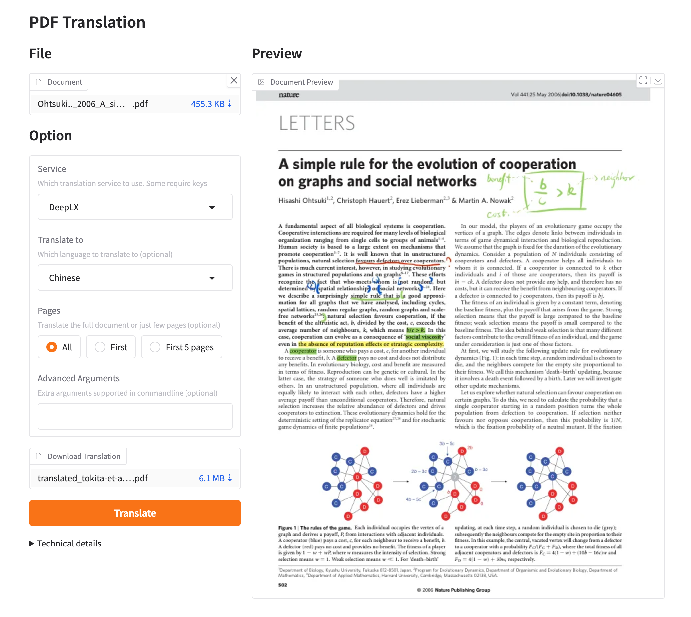
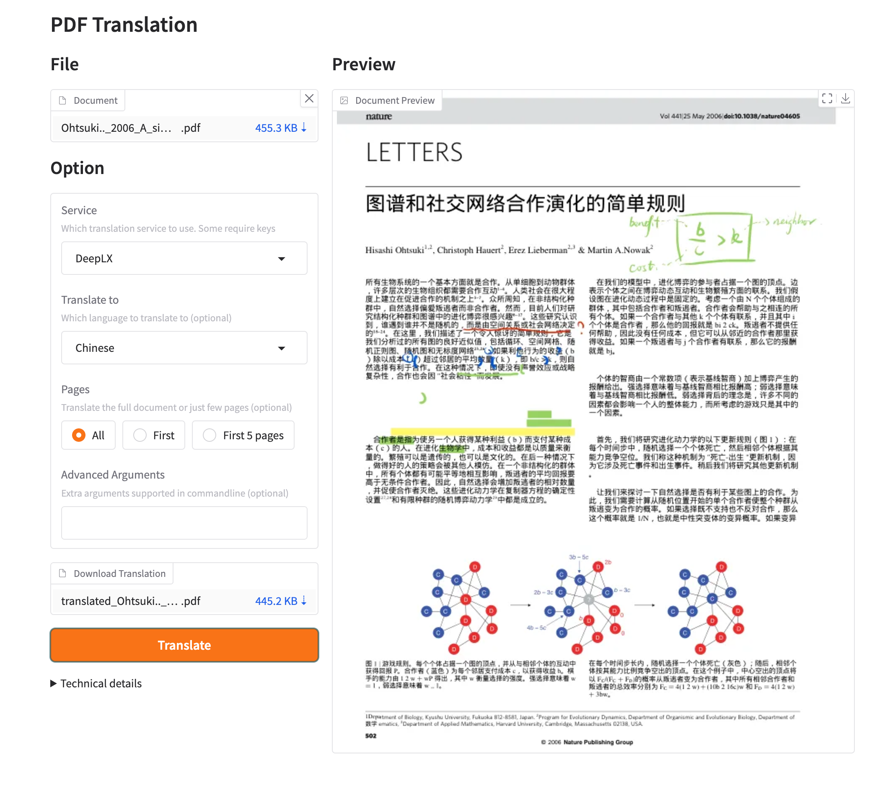

[**Getting Started**](./getting-started.md) > **Usage** > **Web UI** _(current)_

---

# Use the GBabelDocUI Web UI

GBabelDocUI does not open a browser automatically. Start the service, then open its login page yourself.

## Run from the repository

Python 3.10 through 3.13, Git, and [`uv`](https://docs.astral.sh/uv/) are required.

```bash
git clone https://github.com/SocialYjj/GBabelDocUI.git
cd GBabelDocUI
uv sync --frozen
```

For local HTTP, disable the Secure cookie flag before starting the service:

=== "Linux and macOS"

    ```bash
    export GBABELDOCUI_COOKIE_SECURE=false
    uv run gbabeldocui
    ```

=== "Windows PowerShell"

    ```powershell
    $env:GBABELDOCUI_COOKIE_SECURE = "false"
    uv run gbabeldocui
    ```

Open `http://127.0.0.1:7860/login.html`.

## First use

1. Create the initial administrator from the local login page.
2. Open **Settings** and configure OpenAI, Azure OpenAI, or Google Gemini.
3. Select the source language, target language, output type, page range, and advanced PDF options.
4. Open **Upload**, select a PDF, and start the task.
5. Monitor active tasks and download completed monolingual or bilingual PDFs from the history list.

Saved API keys remain server-side and are not returned to the browser. The `data/` directory can still contain credentials, uploaded PDFs, and outputs, so it must not be committed or published.

## Docker use

Use the repository [`docker-compose.yml`](./INSTALLATION_docker.md). It keeps application data in `./data`, model and font caches in a named volume, and binds the service to `127.0.0.1:7860` by default.

For public access, use an HTTPS reverse proxy, keep `GBABELDOCUI_COOKIE_SECURE=true`, and run only one application process and one replica for the data directory.

## Preview



