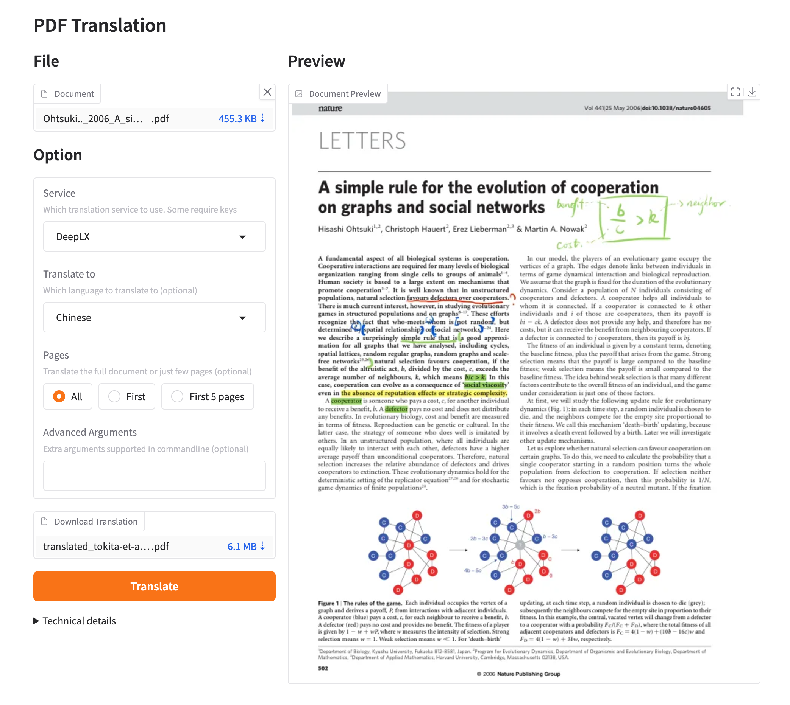
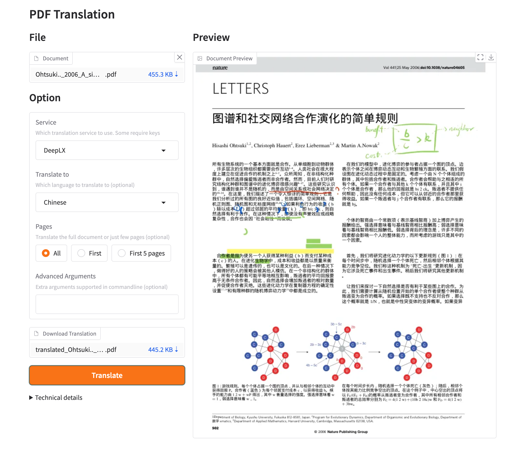

[**開始使用**](./getting-started.md) > **使用** > **Web UI** _(目前頁面)_

---

# 使用 GBabelDocUI Web UI

GBabelDocUI 啟動後不會自動開啟瀏覽器，需要手動前往登入頁。

## 從儲存庫執行

需要 Python 3.10–3.13、Git 與 [`uv`](https://docs.astral.sh/uv/)。

```bash
git clone https://github.com/SocialYjj/GBabelDocUI.git
cd GBabelDocUI
uv sync --frozen
```

本機使用明文 HTTP 時，請先關閉 Cookie 的 Secure 標記：

=== "Linux 與 macOS"

    ```bash
    export GBABELDOCUI_COOKIE_SECURE=false
    uv run gbabeldocui
    ```

=== "Windows PowerShell"

    ```powershell
    $env:GBABELDOCUI_COOKIE_SECURE = "false"
    uv run gbabeldocui
    ```

開啟 `http://127.0.0.1:7860/login.html`。

## 第一次使用

1. 從本機登入頁建立第一個管理員。
2. 開啟「設定」，設定 OpenAI、Azure OpenAI 或 Google Gemini。
3. 選擇來源語言、目標語言、輸出類型、頁面範圍與 PDF 進階選項。
4. 開啟「上傳」，選擇 PDF 並啟動任務。
5. 在任務與歷史記錄中查看進度，完成後下載單語或雙語 PDF。

已儲存的 API 金鑰只保留在伺服器端，不會傳回瀏覽器。`data/` 目錄仍可能包含憑證、上傳 PDF 與輸出檔案，禁止提交或公開。

## Docker 使用

使用儲存庫提供的 [`docker-compose.yml`](./INSTALLATION_docker.md)。它會將應用程式資料保存在 `./data`，將模型與字型快取保存在命名磁碟區，並預設只監聽 `127.0.0.1:7860`。

公開存取時必須使用 HTTPS 反向代理，保持 `GBABELDOCUI_COOKIE_SECURE=true`，並確保每個資料目錄只有一個應用程式程序與一個副本。

## 預覽



