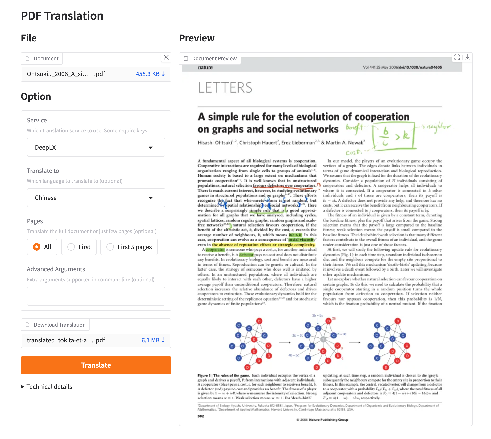
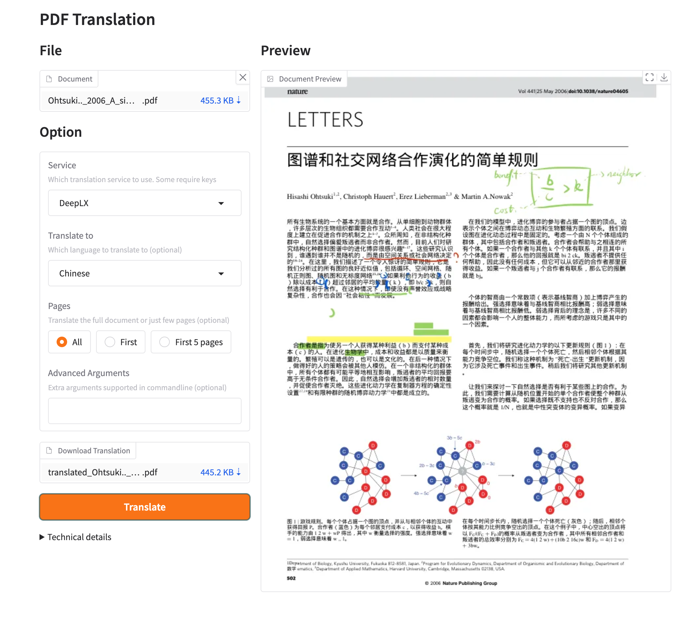

[**开始使用**](./getting-started.md) > **使用** > **Web UI** _(当前)_

---

# 使用 GBabelDocUI Web UI

GBabelDocUI 启动后不会自动打开浏览器，需要手动访问登录页。

## 从仓库运行

需要 Python 3.10–3.13、Git 和 [`uv`](https://docs.astral.sh/uv/)。

```bash
git clone https://github.com/SocialYjj/GBabelDocUI.git
cd GBabelDocUI
uv sync --frozen
```

本机使用明文 HTTP 时，先关闭 Cookie 的 Secure 标志：

=== "Linux 和 macOS"

    ```bash
    export GBABELDOCUI_COOKIE_SECURE=false
    uv run gbabeldocui
    ```

=== "Windows PowerShell"

    ```powershell
    $env:GBABELDOCUI_COOKIE_SECURE = "false"
    uv run gbabeldocui
    ```

打开 `http://127.0.0.1:7860/login.html`。

## 首次使用

1. 从本机登录页创建首个管理员。
2. 打开“设置”，配置 OpenAI、Azure OpenAI 或 Google Gemini。
3. 选择源语言、目标语言、输出类型、页码范围和 PDF 高级选项。
4. 打开“上传”，选择 PDF 并启动任务。
5. 在任务和历史列表中查看进度，完成后下载单语或双语 PDF。

已保存的 API 密钥只保留在服务端，不会返回给浏览器。`data/` 目录仍可能包含凭据、上传 PDF 和输出文件，禁止提交或公开。

## Docker 使用

使用仓库提供的 [`docker-compose.yml`](./INSTALLATION_docker.md)。它将应用数据保存在 `./data`，将模型和字体缓存保存在命名卷中，并默认只监听 `127.0.0.1:7860`。

公开访问时必须使用 HTTPS 反向代理，保持 `GBABELDOCUI_COOKIE_SECURE=true`，并确保每个数据目录只有一个应用进程和一个副本。

## 预览



